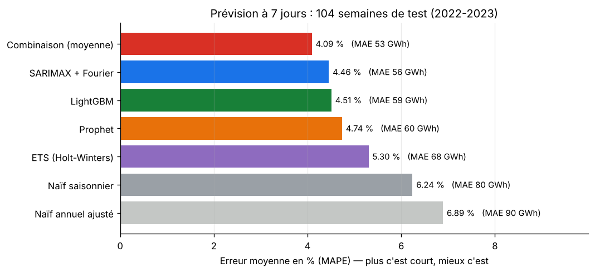
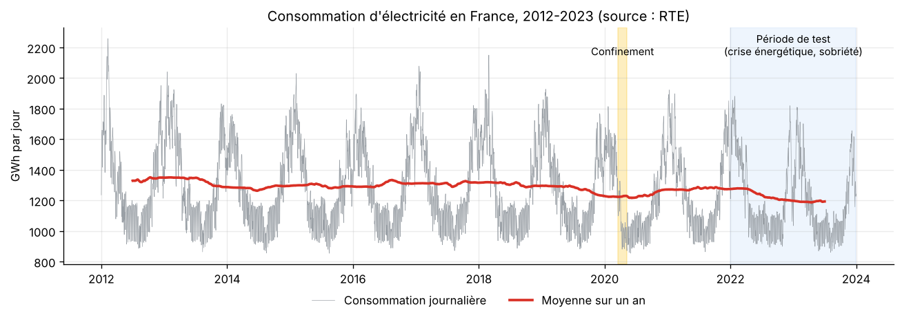
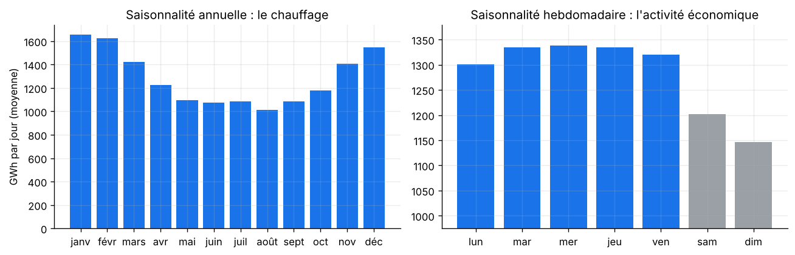
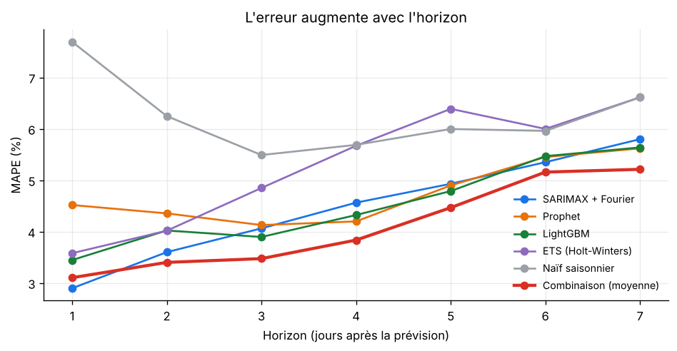
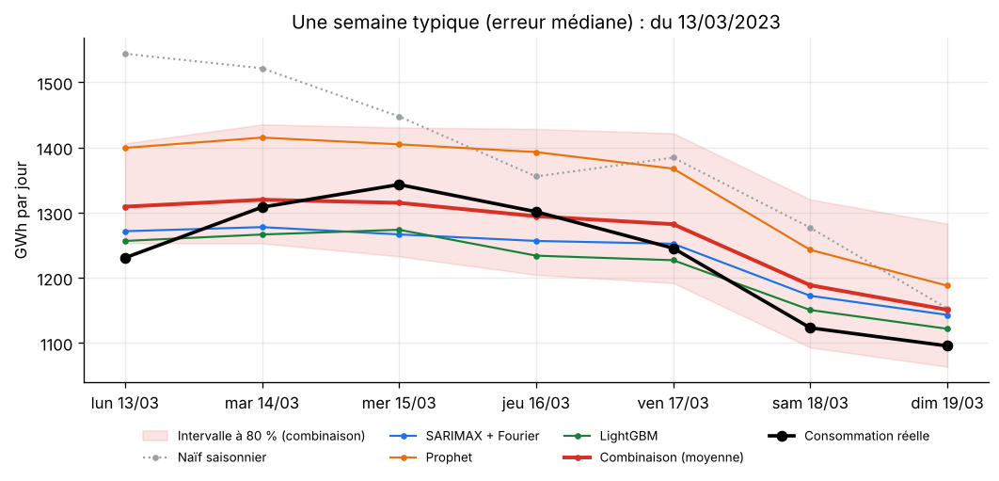
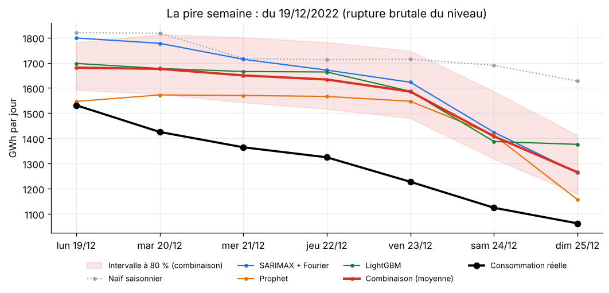
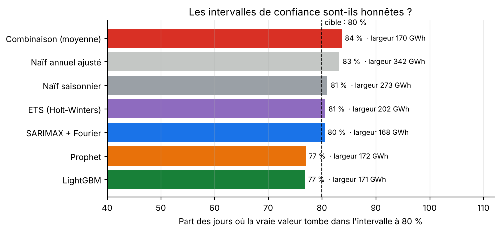
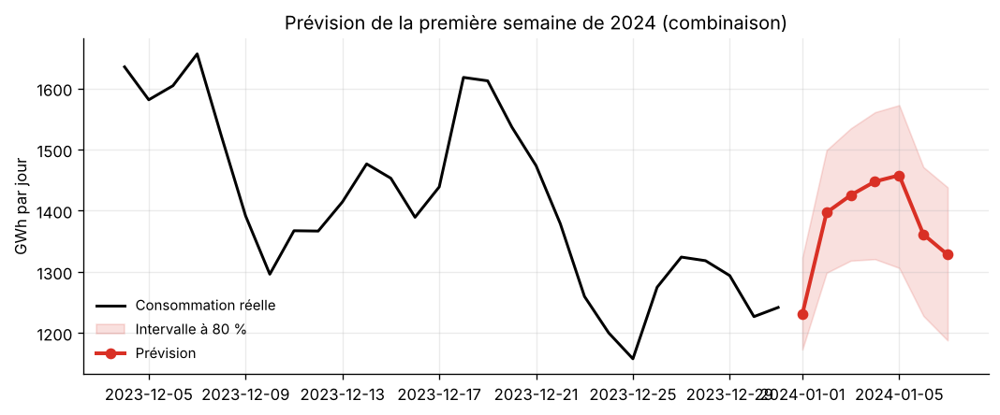

<div align="center">

# ⚡ Prévision de la consommation électrique

**Étude comparative de 7 modèles de séries temporelles pour prévoir la consommation d'électricité française à 7 jours.**

Références naïves · ETS · SARIMAX · Prophet · LightGBM · combinaison de modèles — données RTE 2012-2023


</div>

---

## 📌 Sommaire
- [La question](#-la-question)
- [Résultats en un coup d'œil](#-résultats-en-un-coup-dœil)
- [Les données](#-les-données)
- [Le protocole : comparer honnêtement](#-le-protocole--comparer-honnêtement)
- [Les 7 modèles](#-les-7-modèles)
- [Analyse des résultats](#-analyse-des-résultats)
- [Lancer le projet](#-lancer-le-projet)
- [Organisation du code](#-organisation-du-code)
- [Limites et pistes](#-limites-et-pistes)

---

## 🎯 La question

L'électricité se stocke très mal : à chaque instant, la production doit égaler la consommation.
Pour planifier les centrales, les achats d'énergie et la maintenance, un gestionnaire doit savoir **chaque dimanche soir
combien la France consommera chaque jour de la semaine suivante**.

**Quel modèle fait la meilleure prévision ?** Et surtout : ses écarts avec les autres sont-ils **réels**, ou dus au hasard ?

---

## 🏆 Résultats en un coup d'œil



| Modèle | Famille | Erreur (MAPE) | MAE (GWh/jour) | MASE | Couverture de l'intervalle à 80 % |
|---|---|:-:|:-:|:-:|:-:|
| **Combinaison (moyenne)** | Combinaison | **4,09 %** | **52,7** | **0,65** | 84 % |
| SARIMAX + Fourier | Statistique | 4,46 % | 56,1 | 0,69 | 80 % |
| LightGBM | Machine learning | 4,51 % | 59,3 | 0,73 | 77 % |
| Prophet | Statistique | 4,74 % | 60,4 | 0,74 | 77 % |
| ETS (Holt-Winters) | Statistique | 5,30 % | 67,8 | 0,83 | 81 % |
| Naïf saisonnier | Référence | 6,24 % | 80,4 | 0,98 | 81 % |
| Naïf annuel ajusté | Référence | 6,89 % | 89,9 | 1,10 | 83 % |

*104 semaines de test (2022-2023), soit 728 jours prévus par modèle. MASE < 1 : meilleur que la référence naïve.*

**Les 4 enseignements :**
1. **La combinaison gagne** : la moyenne de 3 modèles de familles différentes réduit l'erreur de **34 %** par rapport au naïf saisonnier
   (53 GWh contre 80 GWh par jour). Ses erreurs individuelles se compensent.
2. **Le meilleur modèle seul n'est pas « significativement » battu** : l'écart entre la combinaison et SARIMAX
   n'est **pas statistiquement significatif** (test de Diebold-Mariano, p = 0,18). Tous les autres écarts le sont (p < 0,02).
3. **Le machine learning ne gagne pas d'office** : un SARIMAX bien construit fait jeu égal avec LightGBM sur ce problème.
4. **Sans la météo, l'hiver reste difficile** : l'erreur est 1,8 fois plus forte en hiver (5,6 % contre 3,1 % en été), et la pire semaine est ratée par tous les modèles.

---

## 📊 Les données

**Source** : RTE, application [éCO2mix](https://www.rte-france.com/eco2mix/telecharger-les-indicateurs) — consommation nationale
au pas de 30 minutes, du **1er janvier 2012 au 31 décembre 2023** (210 384 mesures, aucune valeur manquante),
agrégée en **énergie consommée par jour** (GWh). Données ouvertes de RTE, récupérées via le jeu `Electricity`
du paquet R [rjd3toolkit](https://github.com/rjdverse/rjd3toolkit).



L'exploration ([`notebooks/exploration.ipynb`](notebooks/exploration.ipynb)) montre :



- **une saison annuelle très forte** : 1 654 GWh par jour en janvier contre 1 013 en août, à cause du chauffage électrique ;
- **une saison hebdomadaire** : le dimanche consomme environ 14 % de moins qu'un jour de semaine ;
- **l'effet des jours fériés** : un jour férié en semaine fait chuter la consommation de 18 %, un pont de 13 % ;
- **deux ruptures** : le confinement de 2020, puis la **crise énergétique de 2022** — l'hiver 2022-2023 consomme
  **9,5 % de moins** que la moyenne 2014-2019 (prix, plan de sobriété).

La période de test 2022-2023 est donc **exigeante** : les modèles doivent encaisser une rupture de niveau jamais vue dans le passé.

---

## 🧪 Le protocole : comparer honnêtement

Une erreur fréquente est de comparer des modèles sur un seul découpage « entraînement / test ».
Ici, on reproduit **exactement l'usage réel**, par **validation glissante** :

```
chaque dimanche soir de 2022 et 2023 (104 fois) :
    chaque modèle reçoit TOUT l'historique jusqu'à ce dimanche, et RIEN après
    il prévoit les 7 jours suivants, avec un intervalle à 80 %
    on compare à la consommation réelle
```

- **Aucune fuite du futur** : un test automatique falsifie les données futures et vérifie que les variables
  de prévision ne changent pas.
- **Réestimation** toutes les 4 semaines pour les modèles lents ; entre-temps ils reçoivent les nouvelles observations
  sans réestimer leurs paramètres — comme en production.
- **Métriques** :
  - **MAPE** : l'erreur en % (lisible) ;
  - **MAE** : l'erreur en GWh (l'unité métier) ;
  - **MASE** : l'erreur divisée par celle du modèle naïf (< 1 = utile) ;
  - **biais** : le modèle surestime-t-il ou sous-estime-t-il en moyenne ?
  - **couverture** : la vraie valeur tombe-t-elle vraiment dans l'intervalle à 80 % dans 80 % des cas ?
- **Test de Diebold-Mariano** : la différence d'erreur entre deux modèles est-elle due au hasard ?
  (une valeur par semaine, correction de Newey-West pour l'autocorrélation).

---

## 🧠 Les 7 modèles

| Modèle | Idée | Ce qu'il sait de la série |
|---|---|---|
| **Naïf saisonnier** | « Lundi prochain = lundi dernier » | Rythme hebdomadaire |
| **Naïf annuel ajusté** | « = même jour il y a un an », corrigé du niveau récent | Saison annuelle |
| **ETS (Holt-Winters)** | Lissage exponentiel : le niveau s'adapte progressivement | Niveau + semaine |
| **SARIMAX + Fourier** | SARIMA hebdomadaire (2,0,1)(0,1,1)₇ + termes de Fourier pour l'année + jours fériés, ponts, fêtes | Tout, sauf la météo |
| **Prophet** (Meta) | Tendance par morceaux + saisons + jours fériés français | Tout, sauf la météo |
| **LightGBM** | Arbres de décision boostés, stratégie directe (un modèle pour les 7 horizons) | Tout, sauf la météo |
| **Combinaison** | Moyenne de SARIMAX, Prophet et LightGBM (choisis **à l'avance**, un par famille) | — |

Trois choix de modélisation méritent d'être expliqués :

- **Prévoir le logarithme** : les variations saisonnières sont proportionnelles au niveau (+60 % en hiver).
  En log, elles deviennent additives, ce que les modèles linéaires gèrent bien.
- **LightGBM prévoit un rapport, pas un niveau** : un arbre ne sait pas extrapoler une valeur jamais vue
  (par exemple le niveau bas de la sobriété). On lui fait donc prévoir le rapport « consommation du jour / moyenne des 7 derniers jours »,
  ce qui le rend robuste aux ruptures.
- **Des intervalles conformes pour LightGBM** : ses intervalles par régression quantile étaient trop étroits
  (**60 %** de couverture au lieu de 80 %). On les calibre par **régression quantile conformalisée** (CQR) :
  on mesure sur la dernière année, que le modèle n'a pas vue, de combien ils ratent la cible, puis on les élargit d'autant,
  horizon par horizon. Résultat : **77 %** de couverture.

---

## 🔍 Analyse des résultats

### L'erreur augmente avec l'horizon



| Horizon | J+1 | J+3 | J+5 | J+7 |
|---|:-:|:-:|:-:|:-:|
| SARIMAX + Fourier | **2,90 %** | 4,06 % | 4,93 % | 5,80 % |
| LightGBM | 3,45 % | 3,90 % | 4,79 % | 5,64 % |
| Combinaison | 3,10 % | **3,47 %** | **4,47 %** | **5,21 %** |

SARIMAX est **le meilleur à J+1** (il exploite finement les derniers jours), la combinaison est meilleure ensuite.

### Une semaine typique, et la pire



La semaine d'erreur médiane (mars 2023) : la combinaison suit la réalité de près, le naïf saisonnier en est loin.



La **pire semaine** est celle du **19 décembre 2022** : la consommation **chute de 35 % en une semaine**
(de 1 628 GWh le dimanche 18 à 1 063 GWh le dimanche 25), juste après un pic de consommation (1 819 GWh le 12 décembre)
et au début des vacances de Noël.
Tous les modèles prolongent le niveau élevé de la semaine précédente. **Aucun modèle de ce projet ne connaît la température** :
ce type d'erreur est la limite principale, et la piste d'amélioration n°1.

### Été contre hiver, 2022 contre 2023

| MAPE | Hiver (nov.-mars) | Été (avr.-oct.) | 2022 | 2023 |
|---|:-:|:-:|:-:|:-:|
| Combinaison | 5,57 % | 3,05 % | 4,42 % | 3,76 % |
| SARIMAX + Fourier | 5,86 % | 3,47 % | 4,78 % | 4,14 % |
| LightGBM | 6,37 % | 3,21 % | 4,76 % | 4,27 % |
| Naïf saisonnier | 9,07 % | 4,26 % | 6,23 % | 6,25 % |

- L'hiver est **presque deux fois plus difficile** : la consommation dépend alors du froid, que les modèles ne voient pas.
- 2022, l'année de la rupture, est plus difficile que 2023 pour tous les modèles qui apprennent du passé.

### Les intervalles de confiance sont-ils honnêtes ?



Un intervalle « à 80 % » doit contenir la vraie valeur 80 % du temps. SARIMAX et ETS sont parfaitement calibrés,
la combinaison est légèrement prudente (84 %), Prophet et LightGBM un peu optimistes (77 %).
À couverture égale, l'intervalle le plus **étroit** est le plus utile : celui de SARIMAX et de la combinaison (≈ 170 GWh)
est **38 % plus étroit** que celui du naïf saisonnier (273 GWh).

### Biais

LightGBM **sous-estime** en moyenne de 16 GWh par jour. **64 %** de ce biais vient de **janvier**, et de trois semaines surtout :
- la rentrée du Nouvel An 2022 : sa base de calcul (la moyenne des 7 derniers jours) est écrasée par la semaine de Noël ;
- deux semaines de forte consommation en janvier 2023 : le niveau monte plus vite que ce que le modèle sait anticiper sans la température.

Une variable « nombre de jours de fêtes dans la semaine de référence » a été testée : sans effet, elle a été retirée.

### Le modèle retenu, en production

La **combinaison** est retenue. Elle prévoit la première semaine de 2024, au-delà des données disponibles :



Les valeurs sont dans [`reports/prevision_semaine.csv`](reports/prevision_semaine.csv), et toutes les prévisions
de la validation dans [`reports/previsions_backtest.csv`](reports/previsions_backtest.csv).

> 💡 **Si le calcul devait être simplifié**, SARIMAX seul serait un excellent choix : à peine moins précis
> (écart non significatif), meilleur à J+1, bien calibré, et 4 fois plus rapide que la combinaison.

---

## 🚀 Lancer le projet

**Prérequis** : Python 3.11 ou plus récent.

**Windows, en un double-clic** : `lancer.bat` installe tout, lance l'étude complète (environ 5 minutes) et ouvre le dossier des graphiques.

**À la main :**
```bash
python -m venv .venv
# Windows : .venv\Scripts\activate     macOS / Linux : source .venv/bin/activate
pip install -r requirements.txt

cd src
python -m prevision.run            # étude complète : 104 semaines (≈ 5 min)
python -m prevision.run --rapide   # version rapide : 26 semaines (≈ 1 min)
cd ..
pytest -v                          # 7 tests
```

---

## 🗂️ Organisation du code

```
prevision-electricite/
├── data/raw/consommation_rte_30min.csv   Consommation nationale au pas de 30 min (RTE, 2012-2023)
├── src/prevision/
│   ├── data.py         Chargement, agrégation journalière, calendrier (jours fériés, ponts, fêtes)
│   ├── models.py       Les 6 modèles, avec la même interface fit / update / predict
│   ├── backtest.py     Validation glissante, métriques, test de Diebold-Mariano
│   └── run.py          Étude complète : validation, tableaux, figures, prévision 2024
├── notebooks/exploration.ipynb   Saisonnalités, jours fériés, stationnarité, effet de la sobriété
├── reports/
│   ├── metrics.json              Tous les résultats (global, par année, saison, horizon, tests)
│   ├── previsions_backtest.csv   Les 5 096 prévisions de la validation
│   ├── prevision_semaine.csv     La prévision de la première semaine de 2024
│   └── figures/
├── tests/test_prevision.py       7 tests, dont l'absence de fuite du futur
├── lancer.bat
└── .github/workflows/ci.yml      Tests + étude rapide à chaque push
```

---

## 🧭 Limites et pistes

- **La température** est la variable manquante : la consommation française est très sensible au froid
  (chauffage électrique). L'ajouter (prévisions météo de Météo-France) réduirait surtout les erreurs d'hiver.
  C'est ce que fait RTE pour sa propre prévision à J-1.
- **Le pas de temps** : on prévoit l'énergie journalière ; la prévision au pas de 30 minutes (les pointes du matin et du soir)
  est l'étape suivante, avec des modèles adaptés à plusieurs saisonnalités imbriquées.
- **D'autres modèles** : réseaux de neurones dédiés aux séries temporelles (N-BEATS, TFT) ou modèles de fondation
  (TimeGPT, Chronos), à comparer avec le même protocole.
- **Une combinaison pondérée** (poids appris sur les semaines passées) pourrait faire mieux qu'une simple moyenne,
  au risque de sur-apprendre.

---

## 👤 Auteur

**Elie Samson Kombiwo** — Data Scientist (MLOps / LLMOps)
[GitHub](https://github.com/gitsam1path) · [LinkedIn](https://www.linkedin.com/in/elie-samson-kombiwo-4075a4284)

<sub>Données : RTE, éCO2mix — consommation nationale 2012-2023, via le jeu `Electricity` du paquet
[rjd3toolkit](https://github.com/rjdverse/rjd3toolkit).</sub>
